## 루스하르트 저택 방문
루스하르트 저택 입구에 있는 경비병에게 영주님을 뵙고 싶다고 하면 안으로 들여보내 줍니다.

쿤즐린 루스하르트와 로사 루스하르트, 마틴 오데린이 대화를 하고 있습니다.

이후 어떤 대화를 선택하던 진행에 영향이 없습니다.

## 흐라데츠의 울리히 바바크와 대화
대화 도중에 **흐라데츠의 울리히 바바크**의 습격이 일어나고 바바크와 대화를 이어갑니다.

* 당신은 국왕의 은을 대규모로 빼돌렸습니다.

위 대화 후 기술 판정을 하는데, 통과해야 전투 없이 그를 설득할 수 있습니다.

되도록 장부 증거를 들이대서 학문 판정을 통과하는데 쉽습니다.

만약 기술 판정에 실패했다면, 바바크와 그의 병사들과 전투가 일어납니다.

이후 이어지는 대화에서 다시 기술 판정이 있는데, 어떤 결과가 나오던 정보를 얻을 수 있습니다.

## 로사 루스하르트와 대화
좀 더 자세한 정보를 얻기 위해서 따로 **로사 루스하르트**를 만나 대화를 이어갑니다.

* 길가의 기도소요?
* 영리한 해결책이군요…(평판 상승)
* 순순히 믿으면 안 될 것 같은데요.
* 같이 갑시다!
* 짐이라니, 그렇지 않습니다!(평판 상승)
* 무슨 일이시죠?
* (학문 판정)그게 무슨 책인데요?(평판 상승)
* 제가 책을 찾아오겠습니다, 걱정하지 마십시오!(평판 상승) → 임무 [로사의 책](https://godel99.github.io/posts/127.로사의-책/) 발생

로사와 대화 후, 로사가 **말레쇼프 탑 지도와 말레쇼프 요새 지도**를 줍니다.

임무에 대한 대화를 모두 끝내고, 로사와 추가로 더 대화를 이어가면 평판이 상승할 수 있습니다.

떠나기 전에 꼭 **삽**을 챙겨 가야 합니다.

## 마부 하슈탈과 대화
지도에 표시된 밀레쇼프 서쪽에 있는 마구간에 **마부 하슈탈**과 대화를 합니다.

* 루스하르트 가의 명령을 받고 왔습니다.

그와 모든 대화를 해주면 임무가 갱신됩니다.

## 비밀 통로 입구 찾기
지도에 위치 범위가 표시되며, 먼저 **기도소**를 찾아야 합니다.

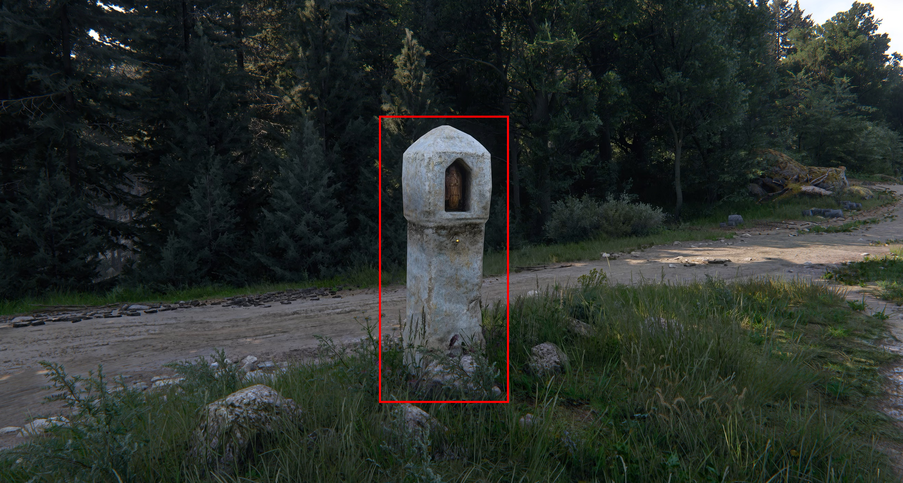

기도소를 지나서 숲 속으로 들어가면 네모난 창이 보이는 돌조각이 있는데, 창으로 바라보는 곳에 오래된 예배당이 있습니다.

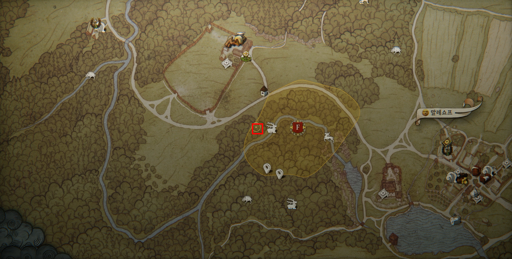

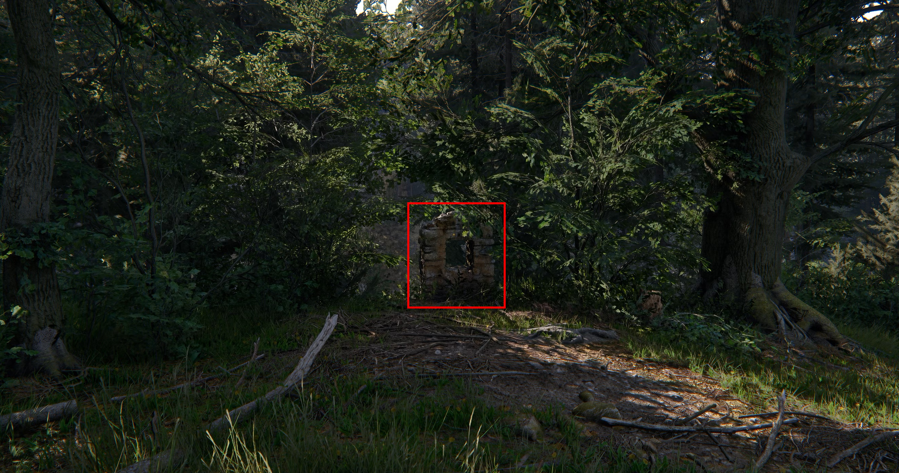

오래된 예배당에 가서 누워있는 십자가를 발견할 수 있는데, 누워 있는 십자가가 가르키는 곳에 **흰 나무**를 향해 갑니다.

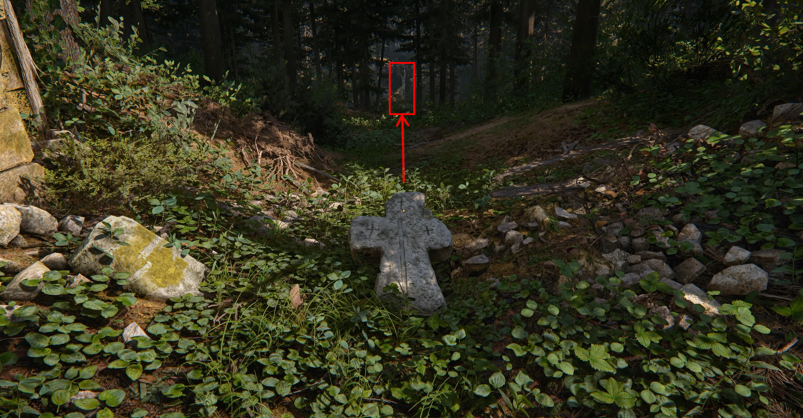

가는 도중 늑대 무리를 만나면, 처치해 줍니다

십자가가 가르키는 곳을 향해 쭉 진행하면 나무 근처에 또다른 십자가가 놓여져 있고, 다시 그 십자가가 가르키는 곳을 향해 앞으로 전진합니다.

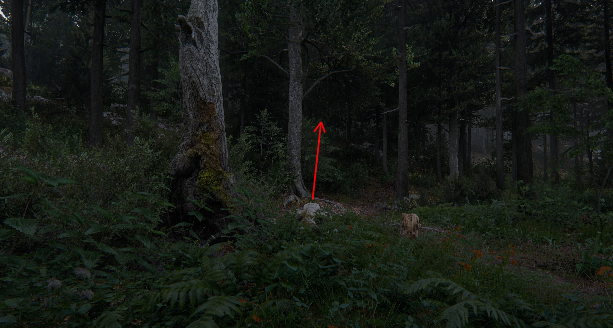

그럼 다시 큰 나무 곁에 놓여 있는 십자가를 발견할 수 있고, 그 바닥을 삽으로 팔 수 있는 상호작용이 나타납니다.

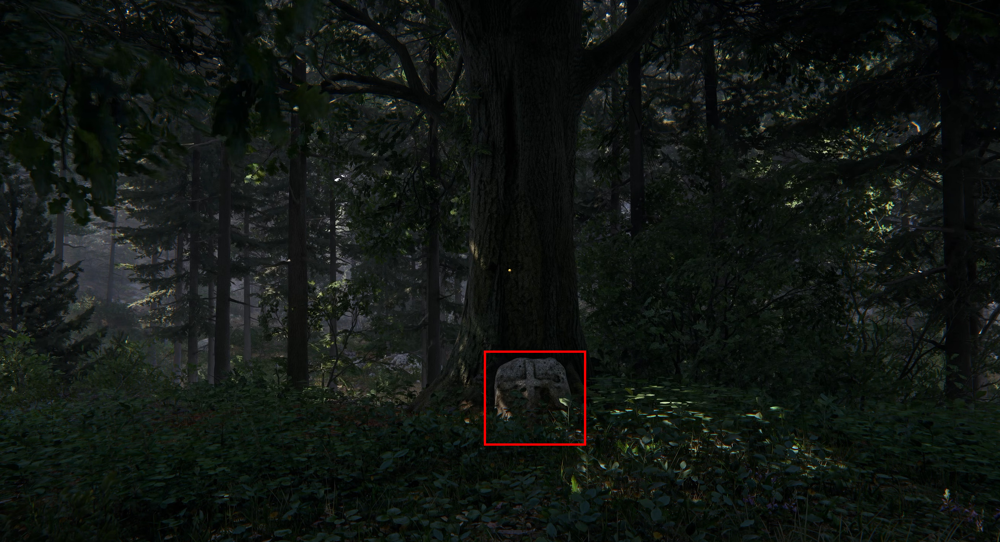

## 말레쇼프 요새 침입
비밀 통로를 이용해서 말레쇼프 요새에 몰래 침입할 수 있습니다.

비밀 통로를 지나서 말레쇼프 요새 벽과 상호 작용을 할 수 있습니다.

말레쇼프에 침입하면, 컷신이 발생합니다.

컷신 이후 말레쇼프 요새 안에서는 경비가 삼엄해서 되도록 숨어서 이동을 해야 합니다.

요새 안을 돌아다니다 보면, 주방장의 **요리사 드라호미라**를 만날 수 있는데 그녀와 대화에서 매력 판정에 성공하면 대화가 가능합니다.

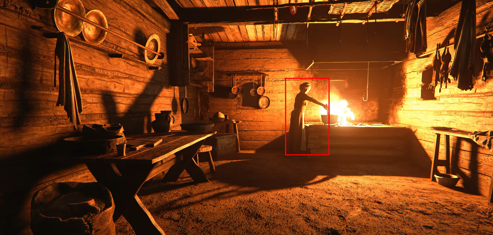

그녀와 대화에서, 

* 요새에서 하룻밤 묵고 싶다.

위와 같이 선택하면, 말레쇼프 요새 열쇠를 줍니다.

또 그녀에게 포로에 대해서 묻고, 포로가 갇혀 있는 방 문의 열쇠, **말레쇼프 탑 열쇠**를 200 그로센에 살 수도 있습니다. 그러나 굳이 살 필요는 없습니다.

또 다른 방법은 몰래 그녀의 뒷주머니에서 열쇠를 모두 훔칠 수도 있습니다.

이제 건물 안으로 잠입해야 하는데, 경비병들이 있다면 돌로 시선을 분산 시켜서 건물에 잠입합니다.

건물 내부로 들어오면 2층으로 올라가는 계단 앞에 병사들이 이야기를 주고 받고 있습니다.

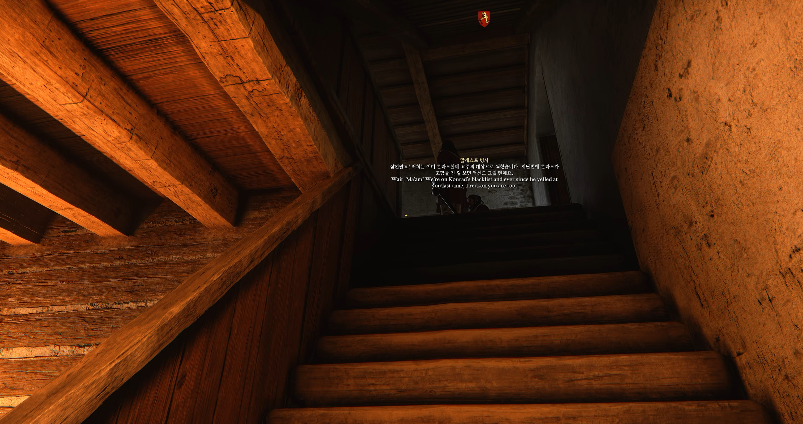

잠시 기다려면 아래층으로 내려오니 잠시만 피해서 기다려 줍니다.

건물 2층으로 올라가서, **오필리아 부인**이 앉아 있는 방이 있습니다.

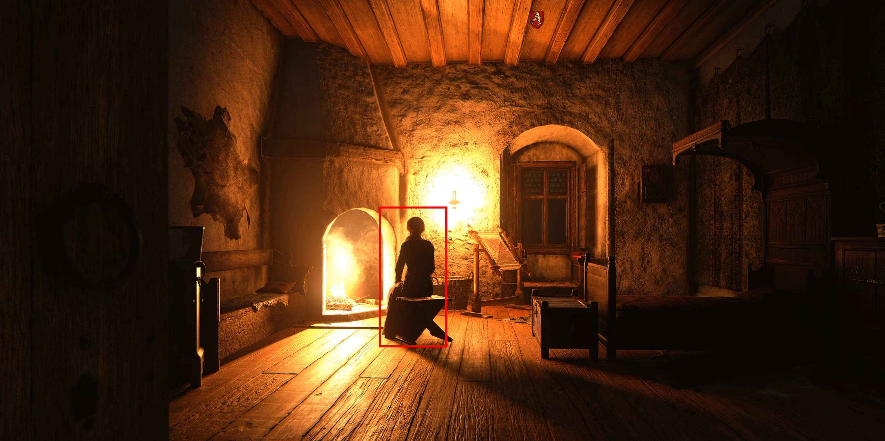

오필리아 부인과도 대화가 가능하며 기술 판정을 통과하면 그녀는 방까지 안내를 해주지만, 굳이 그럴 필요 없이 뒤에서 기절을 시키는 게 무난합니다.

오필리아 부인의 방에서 **검 두 자루**와 로사가 찾아달라고 했던 재미있는 이야기 모음집을 챙겨줍니다.

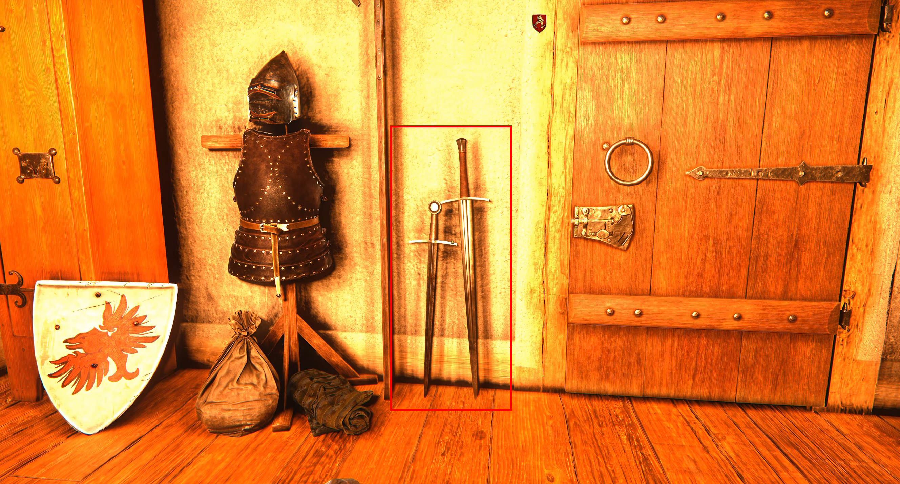

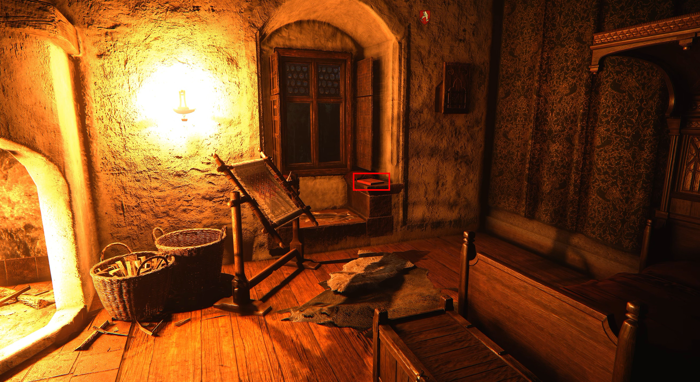

또, 그녀의 방에서 아래의 사진의 위치에 있는 말레쇼프 탑 열쇠도 챙겨줍니다.

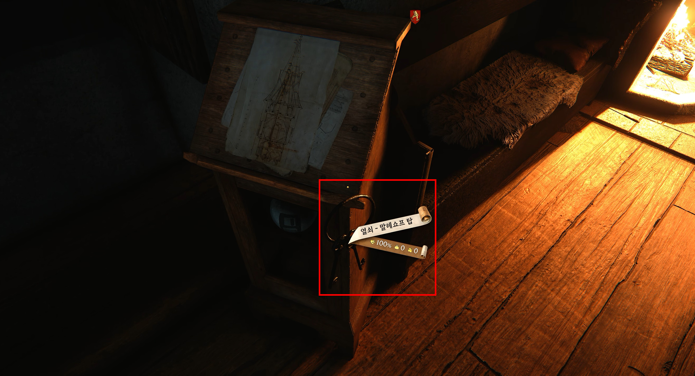

다시 건물 꼭대기 층으로 올라가서 잠겨 있는 방을 말레쇼프 요새 열쇠로 따고 들어가면 **한스 케이폰과 바클린 브라반트**라는 자를 드디어 만날 수 있습니다.

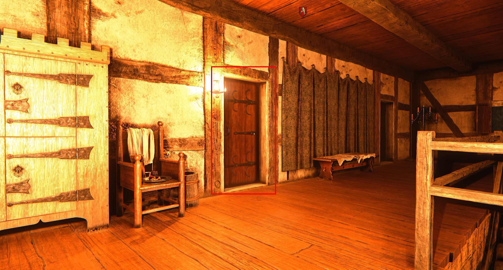
  
* 뭐라고요?
* (연인)함께 이겨낼 수 있을 겁니다. OR 비밀 통로가 최선의 방법입니다.

이후 한스와 브라반트에게 검을 건넵니다.

* 경로를 정찰하겠습니다.

## 말레쇼프 요새 탈출
여기서 한스를 뒤에서 기절 시키고, 업고 비밀 통로로 나오는 방법도 있습니다.

다른 방법은 마구간까지 몰래 가서 말을 타고 요새 입구를 통해 빠져 나가는 방법도 있습니다.

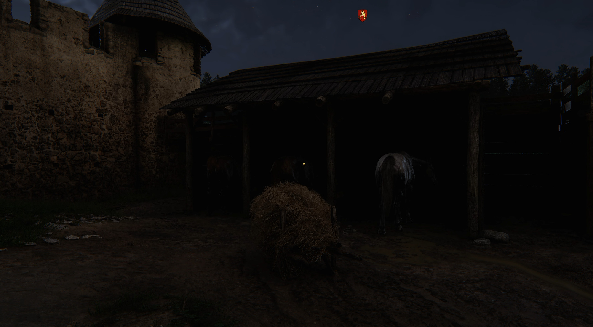

말을 타고 탈출하려면 마구간까지 숨어서 이동해야 하며, 마주치는 경비병들을 모두 기절 시켜놓는 게 좋습니다.

마구간에 도착하면, **횃불**을 들어서 한스에게 신호를 보냅니다.

한스가 마구간에 도착하면, 요새 정문을 열어야 하며 입구에서 상호작용 후 컷신이 발생합니다.

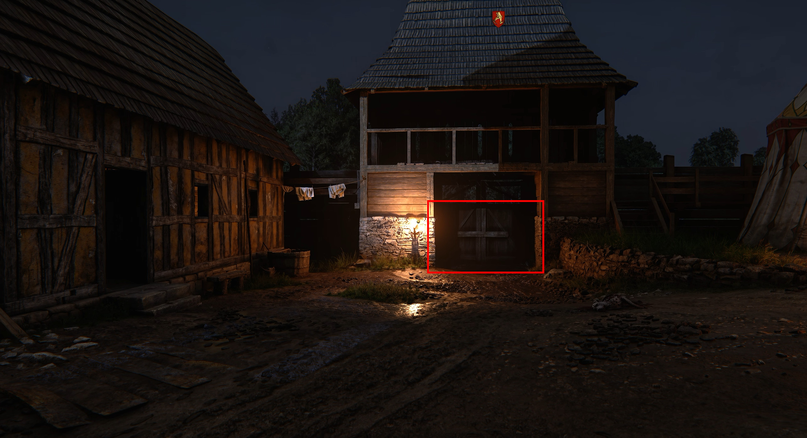

탈출 이후, 대화는 임무 진행에 영향을 주지 않으니 원하는 선택을 하면 됩니다.

여기까지 비밀 탈출 작전 공략을 마치겠습니다.
